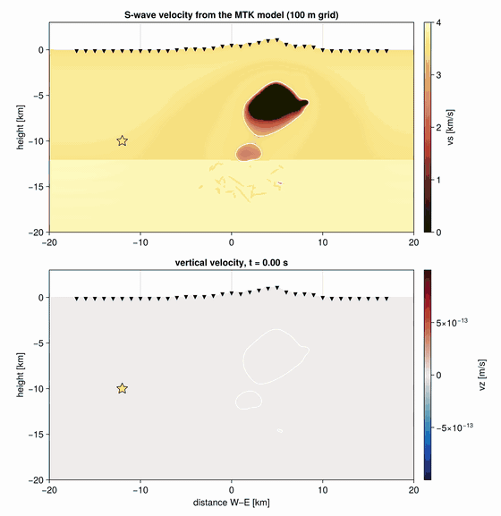
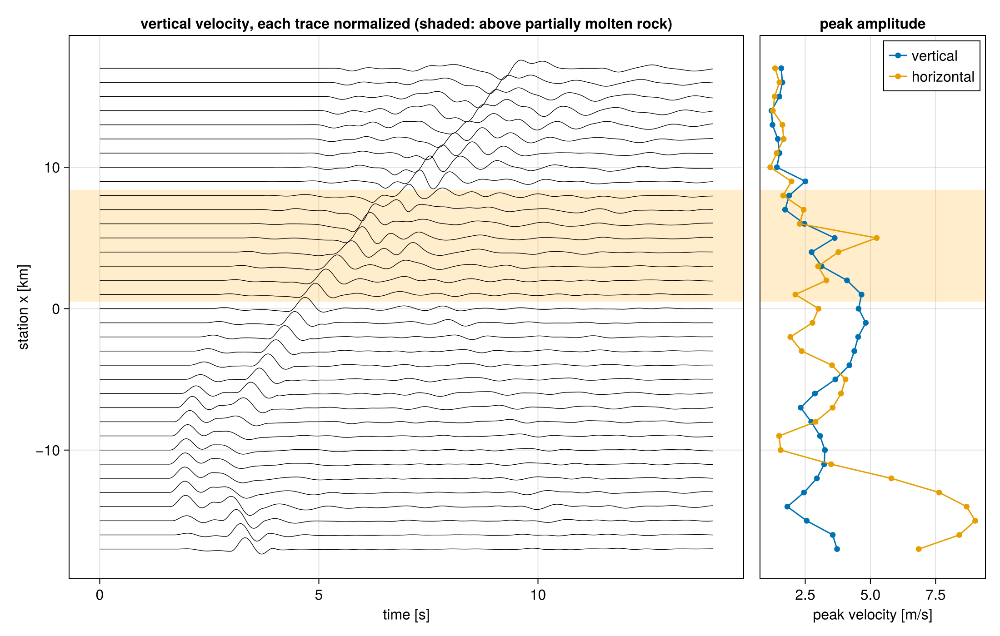
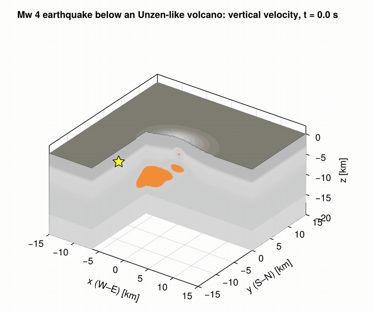

[](https://github.com/JuliaGeodynamics/SeismicWavePC.jl/actions/workflows/CI.yml)
[](https://juliageodynamics.github.io/SeismicWavePC.jl/dev/)

# SeismicWavePC.jl

**Seismic wave propagation and full-waveform inversion (FWI) in 2D and 3D visco-elastic media, in pure Julia, on CPUs,
GPUs and MPI clusters.**





*A Mw 4 earthquake below Unzen, through the temperature field of a
[MagmaThermoKinematics.jl](https://github.com/boriskaus/MagmaThermoKinematics.jl) model with MAGEMin velocities (white lines:
more than 10 % melt). Stations above the partially molten region (shaded) record weaker S waves and a longer coda
([example](examples/MagmaThermoKinematics/Unzen_2D.jl)).*

SeismicWavePC.jl simulates seismic waves through any model built with
[GeophysicalModelGenerator.jl](https://github.com/JuliaGeodynamics/GeophysicalModelGenerator.jl) and computes exact misfit
gradients for full-waveform inversion. It started as a Julia port of [OpenSWPC](https://openswpc.github.io) (Maeda et al.,
2017), whose seismograms it reproduces to round-off, and has grown well beyond it.

- **Visco-elastic waves** in 2D (P-SV, SH) and 3D, with topography, oceans, constant Q, and PML absorbing boundaries;
  sources and receivers at the grid cells (as OpenSWPC) or anywhere in between (sinc interpolation), grids that are
  finer near the surface (stretched in depth), and teleseismic P, SV and SH plane waves at any angle and backazimuth
  (injected exactly along a box in a layered background).
- **Fast everywhere:** Julia threads (faster than OpenSWPC), GPUs from NVIDIA, AMD and Apple, and MPI for several GPUs or nodes.
- **Any GMG model:** geology tools, geographic data, thermal models
  ([MagmaThermoKinematics.jl](https://github.com/boriskaus/MagmaThermoKinematics.jl)), phase diagrams
  ([MAGEMin](https://github.com/ComputationalThermodynamics/MAGEMin_C.jl)), random media.
- **Full-waveform inversion (FWI):** exact adjoint-state gradients of least-squares, travel-time or custom misfits with
  respect to the model (`rho`, `vp`, `vs`, `Qp`, `Qs`) and the sources, for several shots, at the cost of about 5
  simulations, on CPUs, GPUs and MPI; reverse-time migration (RTM) with illumination compensation.
- **Deterministic and Bayesian FWI** with Optim.jl (L-BFGS), Turing.jl and AdvancedHMC.jl (Hamiltonian Monte Carlo), and
  other Julia packages.
- **Live output:** plot or film the waves while the simulation runs; SAC and netCDF files for OpenSWPC users.

## 3D: magmatic system below an Unzen-like volcano



*A Mw 4 earthquake below an Unzen-like volcano. The magmatic system is a temperature field (a geotherm plus Gaussian
anomalies) turned into velocities and melt with MAGEMin; orange marks partially molten rock
([example](examples/MagmaThermoKinematics/Unzen_3D.jl)).*

## Installation

```julia
julia> ]
pkg> add https://github.com/JuliaGeodynamics/SeismicWavePC.jl
```
Start Julia with `julia -t auto` to use all cores; for GPUs add `CUDA`, `AMDGPU` or `Metal`.

## Example

```julia
using SeismicWavePC, GeophysicalModelGenerator

x, z = range(-10, 10, length=400), range(-8, 2, length=201)           # 2D model [km], z up
X, _, Z = xyz_grid(x, 0, z)
air = Z .> exp.(-(X ./ 2) .^ 2)                                       # air above a 1 km high hill
model = CartData(X, zero(X), Z, (; rho=ifelse.(air, 1.0, 2700.0), vp=ifelse.(air, 0.0, 5.5), vs=ifelse.(air, 0.0, 3.2)))

source   = DoubleCoupleSource(-3.0, 0.0, -4.0; Mw=3.5, strike=0, dip=45, rake=90, trise=0.4)
stations = [Station("S$i", xs, 0.0, 0.0; surface=true) for (i, xs) in enumerate(-8:2:8)]
result   = simulate(model; dt=0.004, nt=1500, sources=source, stations)     # backend=CUDABackend() for a GPU

J, gradient = misfit_gradient(model, observed; dt=0.004, nt=1500, sources=source)   # observed: recorded Seismograms
```

## Documentation

The [documentation](https://juliageodynamics.github.io/SeismicWavePC.jl/dev/) covers models, sources, GPUs and MPI, gradients,
inversion with Turing, AdvancedHMC and Optim, the [examples](https://juliageodynamics.github.io/SeismicWavePC.jl/dev/examples/)
(3D volcanoes, Unzen, Marmousi2, Bayesian inversion), the transition from OpenSWPC, validation and
[performance](https://juliageodynamics.github.io/SeismicWavePC.jl/dev/performance/): on the Marmousi2 benchmark a laptop GPU is 6×
faster than OpenSWPC on 12 MPI ranks, and a misfit gradient is 19× faster than with SeismicWaves.jl (comparisons with
JUDI.jl/Devito included).

## References and license

Maeda, T., Takemura, S., and Furumura, T. (2017). OpenSWPC: an open-source integrated parallel simulation code for modeling
seismic wave propagation in 3D heterogeneous viscoelastic media. *Earth, Planets and Space*, 69, 102.
doi:10.1186/s40623-017-0687-2

MIT license. The forward numerical algorithms are ported from OpenSWPC, © Takuto Maeda, MIT license.
