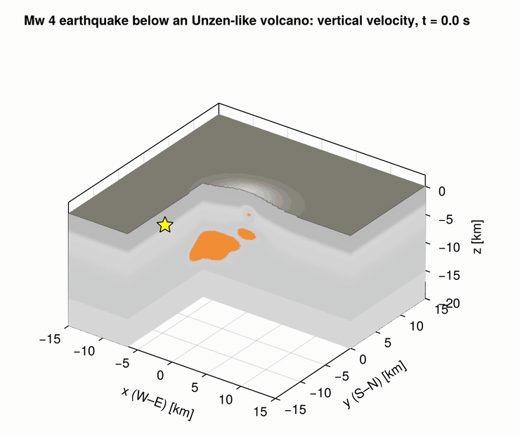
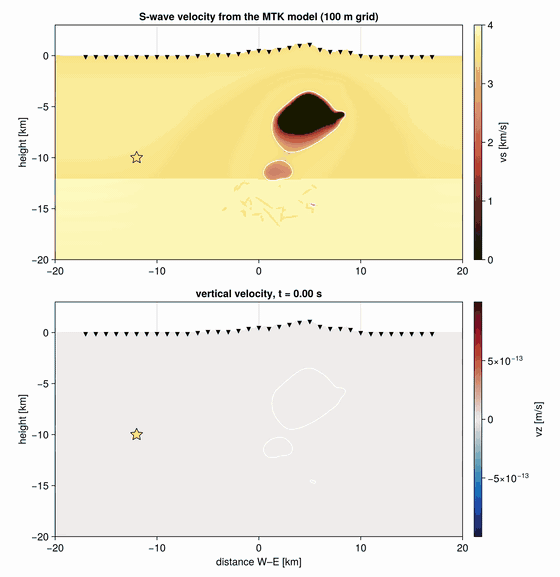
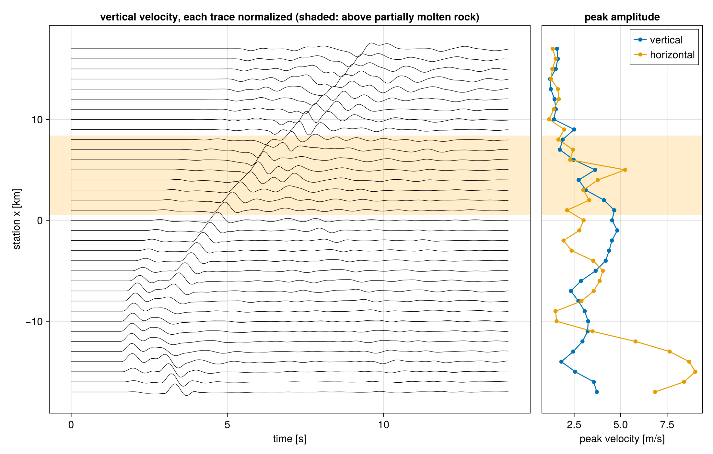
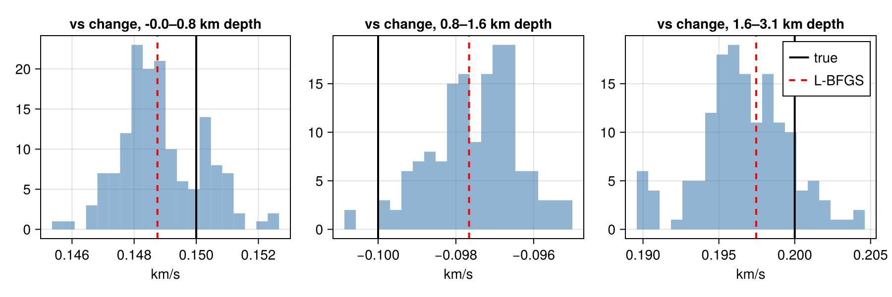

# Examples

The examples are in the [`examples`](https://github.com/boriskaus/SeismicWavePC.jl/tree/main/examples) folder of the
repository (see [Installation](@ref) for their environments). Most take `cuda`, `amdgpu` or `metal` as last argument to run
on a GPU.

## 3D: waves through the magmatic system below an Unzen-like volcano

[`MagmaThermoKinematics/Unzen_3D.jl`](https://github.com/boriskaus/SeismicWavePC.jl/blob/main/examples/MagmaThermoKinematics/Unzen_3D.jl): a volcano on a peninsula, with a temperature
field from a linear geotherm and superposed Gaussian anomalies (a deep mush reservoir, a body rising from it, a reservoir
below the summit). MAGEMin phase diagrams give density, velocities and melt fraction; partially molten rock has a low Q.
The movie of a Mw 4 earthquake is made while the simulation runs.

## 3D: a volcano with a magma chamber

[`3D_volcano.jl`](https://github.com/boriskaus/SeismicWavePC.jl/blob/main/examples/3D_volcano.jl) builds a volcano with GMG (`add_volcano!`), a magma chamber and stations given in
longitude and latitude; [`3D_mpi.jl`](https://github.com/boriskaus/SeismicWavePC.jl/blob/main/examples/3D_mpi.jl) runs it on 4 MPI processes, and
[`3D_volcano_movie.jl`](https://github.com/boriskaus/SeismicWavePC.jl/blob/main/examples/3D_volcano_movie.jl) makes a movie of it:

## 2D: Unzen from MagmaThermoKinematics.jl and MAGEMin

[`MagmaThermoKinematics/Unzen_2D.jl`](https://github.com/boriskaus/SeismicWavePC.jl/blob/main/examples/MagmaThermoKinematics/Unzen_2D.jl) runs the 2D Unzen model of
[MagmaThermoKinematics.jl](https://github.com/boriskaus/MagmaThermoKinematics.jl) (about 6 minutes at 100 m resolution),
computes density, velocities and melt fraction with [MAGEMin](https://github.com/ComputationalThermodynamics/MAGEMin_C.jl),
and simulates an earthquake recorded by seismometers just below the surface:

*Top: S-wave velocity from MAGEMin for the temperature field of MTK (black: molten, white lines: more than 10 % melt).
Bottom: vertical velocity of a Mw 4 earthquake (star), recorded by seismometers just below the surface (triangles).*

*Vertical velocity at the seismometers (left) and peak velocities (right). Stations above the partially molten region (shaded)
record weaker S waves and a longer coda.*

## Marmousi2

[`Marmousi2.jl`](https://github.com/boriskaus/SeismicWavePC.jl/blob/main/examples/Marmousi2.jl): the elastic Marmousi2 benchmark model (downloaded on first use), a marine shot and its
shot gather; see [Performance](@ref).

## Waveform inversion and Hamiltonian Monte Carlo

In [`examples/Inversion`](https://github.com/boriskaus/SeismicWavePC.jl/tree/main/examples/Inversion) (own environment),
noisy seismograms of one earthquake at 11 stations are inverted for the shear velocity in three depth bands:
- [`inversion_turing.jl`](https://github.com/boriskaus/SeismicWavePC.jl/blob/main/examples/Inversion/inversion_turing.jl): L-BFGS with Optim.jl, then Hamiltonian Monte Carlo (NUTS) with
  Turing.jl;
- [`inversion_hmc.jl`](https://github.com/boriskaus/SeismicWavePC.jl/blob/main/examples/Inversion/inversion_hmc.jl): NUTS with AdvancedHMC.jl directly, without Turing and without AD.

*Posterior distributions (NUTS, Turing) of the shear-velocity changes, with the true values (black) and the L-BFGS result (red).*

## Others

- [`2D_PSV_hill.jl`](https://github.com/boriskaus/SeismicWavePC.jl/blob/main/examples/2D_PSV_hill.jl): layered crust under a hill, with a record section ([Getting started](@ref)).
- [`benchmark.jl`](https://github.com/boriskaus/SeismicWavePC.jl/blob/main/examples/benchmark.jl), [`benchmark_marmousi2.jl`](https://github.com/boriskaus/SeismicWavePC.jl/blob/main/examples/benchmark_marmousi2.jl): the timings in
  [Performance](@ref).
- [`check_cuda.jl`](https://github.com/boriskaus/SeismicWavePC.jl/blob/main/examples/check_cuda.jl), [`check_cuda_mpi.jl`](https://github.com/boriskaus/SeismicWavePC.jl/blob/main/examples/check_cuda_mpi.jl): checks of NVIDIA GPUs and of MPI on GPUs.
