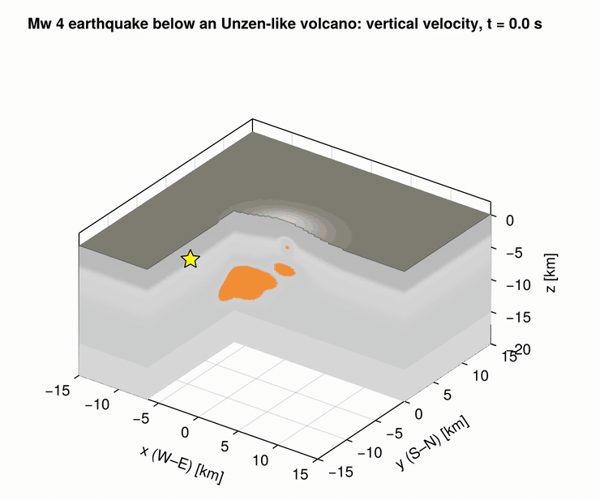

# SeismicWavePC.jl

**Seismic wave propagation and waveform-inversion gradients in 2D and 3D visco-elastic media, in pure Julia, on CPUs, GPUs
and MPI clusters.**



SeismicWavePC.jl simulates seismic waves through any model built with
[GeophysicalModelGenerator.jl](https://github.com/JuliaGeodynamics/GeophysicalModelGenerator.jl) (GMG) and computes exact misfit
gradients for full-waveform inversion. It started as a Julia port of the finite-difference code
[OpenSWPC](https://openswpc.github.io) (Maeda et al., 2017), still reproduces its seismograms to single-precision round-off
([Validation](@ref)), and has since grown well beyond it.

## Features

- **Physics:** P-SV and SH (2D) and 3D visco-elastic waves on a staggered grid (4th order in space, 2nd order in time);
  constant Q (generalized Zener body); free surfaces and topography; oceans; PML or Cerjan absorbing boundaries.
- **Sources and receivers:** moment tensors, double couples, forces and plane waves, in Cartesian or geographic
  coordinates; velocity, displacement, stress and strain seismograms; reciprocal Green's functions.
- **Hardware:** Julia threads on CPUs (faster than OpenSWPC per core and in total), GPUs from NVIDIA, AMD and Apple, and MPI
  for several GPUs or nodes.
- **Models:** any GMG `CartData`: GMG's geology tools and geographic data, thermal models
  ([MagmaThermoKinematics.jl](https://github.com/boriskaus/MagmaThermoKinematics.jl)) and phase diagrams
  ([MAGEMin](https://github.com/ComputationalThermodynamics/MAGEMin_C.jl)), random media, OpenSWPC's model files.
- **Waveform inversion:** exact gradients of least-squares, travel-time or custom misfits with respect to the model
  (`rho`, `vp`, `vs`, `Qp`, `Qs`) and the sources, for several shots, at the cost of about 5 simulations, on CPUs, GPUs and
  MPI ([Misfit gradients](@ref)).
- **Inversion and sampling packages:** Optim.jl, Turing.jl (Hamiltonian Monte Carlo with any of its AD backends),
  AdvancedHMC.jl, DynamicHMC.jl and other LogDensityProblems.jl samplers ([Inversion and sampling packages](@ref)).
- **Output:** seismograms in memory, the wavefield as `CartData`, ParaView movies, or your own plots while the simulation
  runs; SAC and netCDF files as in OpenSWPC ([Coming from OpenSWPC](@ref)).

## Contents

```@contents
Pages = ["installation.md", "getting_started.md", "models.md", "sources_stations.md", "simulations.md", "output.md",
         "gradients.md", "inversion.md", "examples.md", "openswpc.md", "validation.md", "performance.md", "api.md"]
Depth = 1
```

## Reference

Maeda, T., Takemura, S., and Furumura, T. (2017). OpenSWPC: an open-source integrated parallel simulation code for modeling
seismic wave propagation in 3D heterogeneous viscoelastic media. *Earth, Planets and Space*, 69, 102.
doi:10.1186/s40623-017-0687-2

MIT license. The forward numerical algorithms are ported from OpenSWPC, © Takuto Maeda, MIT license.
