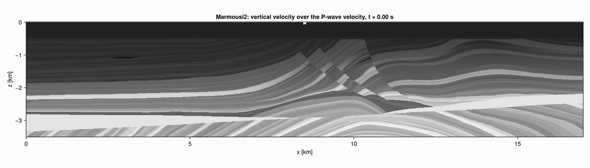
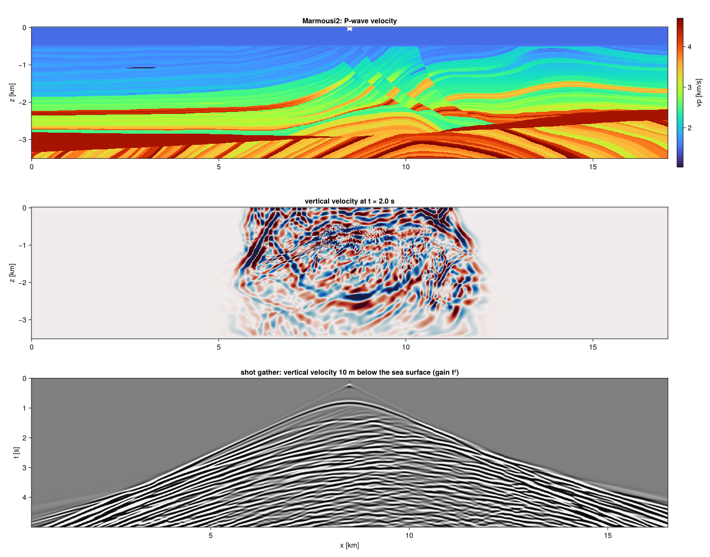

# Performance

## Marmousi2

The elastic Marmousi2 model (Martin et al., 2006; 17 km × 3.5 km, 451 m of water) is the classic benchmark of seismic wave
propagation codes. [`examples/Marmousi2.jl`](https://github.com/boriskaus/SeismicWavePC.jl/blob/main/examples/Marmousi2.jl) downloads it, simulates a marine shot and makes a movie of
the waves over the P-wave velocity while the simulation runs (10 m grid, 5 s, 12 s on a laptop):

Benchmark ([`examples/benchmark_marmousi2.jl`](https://github.com/boriskaus/SeismicWavePC.jl/blob/main/examples/benchmark_marmousi2.jl)): 2D P-SV on a 5 m grid (3401 × 703 cells),
2 s (5317 steps), PML, an explosion 10 m below the sea surface and 641 receivers; time loop only, the better of two runs, on the
Apple M4 Max laptop. [SeismicWaves.jl](https://github.com/GinvLab/SeismicWaves.jl) (v0.9.1, elastic, without attenuation) ran the
same grid, time step and receivers with its threaded CPU backend.

| Code | Time | Million cell updates / s |
|---|---:|---:|
| OpenSWPC, 1 core | 152 s | 84 |
| OpenSWPC, 12 MPI ranks | 16.5 s | 770 |
| SeismicWaves.jl, 12 threads | 170 s (29 s with 1 receiver) | 75 (439) |
| SeismicWavePC.jl, 1 thread | 106 s | 120 |
| SeismicWavePC.jl, 12 threads | 14.9 s | 851 |
| SeismicWavePC.jl, Apple M4 Max GPU (Metal) | 5.0 s | 2552 |

SeismicWavePC.jl and OpenSWPC also update the memory variables of attenuation (Q is infinite here). In SeismicWaves.jl most of
the time goes to recording the 641 receivers; with a single receiver it reaches 439 million updates per second.

Misfit gradient (adjoint-state method, L2 misfit of all receivers) on the same problem.
[`examples/benchmark_marmousi2.jl`](https://github.com/boriskaus/SeismicWavePC.jl/blob/main/examples/benchmark_marmousi2.jl) with `gradient` as second argument:

| Code | Forward | Gradient | Gradient / forward |
|---|---:|---:|---:|
| SeismicWaves.jl, 12 threads, 641 receivers | 169 s | 403 s | 2.4 |
| SeismicWaves.jl, 12 threads, 1 receiver | 30 s | 121 s | 4.0 |
| SeismicWavePC.jl, 12 threads, 641 receivers | 16.9 s | 80 s | 4.7 |
| SeismicWavePC.jl, Apple M4 Max GPU (Metal), 641 receivers | 6.2 s | 30 s | 4.9 |

Both codes save the wavefield every √nt steps or so and recompute the steps in between. The forward times here include the
setup.

## Examples

Seconds per simulation for the two examples, on an Apple M4 Max laptop (12 performance cores, 40-core GPU). These are
wall-clock times of a whole run, including setup (and, for OpenSWPC, writing and reading its input files), without snapshots,
with the same absorbing boundary in both codes. Each time is the better of two runs, with OpenSWPC and Julia runs alternating.
The first run in a new Julia session takes 4–10 s more for compilation.

With the PML (the default of both codes):

| Example | OpenSWPC, 1 core | OpenSWPC, MPI | Julia, 1 thread | Julia, MPI | Julia, 12 threads | Julia, Metal GPU |
|---|---:|---:|---:|---:|---:|---:|
| [2D P-SV hill](https://github.com/boriskaus/SeismicWavePC.jl/blob/main/examples/2D_PSV_hill.jl): 600 × 281 cells, 3000 steps | 6.2 s | 1.7 s (4 ranks) | 4.4 s | 1.9 s (4 ranks) | 1.2 s | 0.28 s |
| [3D volcano](https://github.com/boriskaus/SeismicWavePC.jl/blob/main/examples/3D_volcano.jl): 160 × 160 × 126 cells, 1000 steps | 109 s | 18 s (8 ranks) | 91 s | 22 s (8 ranks) | 14 s | 4.4 s |

With the Cerjan sponge (`absorber=:cerjan`):

| Example | OpenSWPC, 1 core | OpenSWPC, MPI | Julia, 1 thread | Julia, MPI | Julia, 12 threads | Julia, Metal GPU |
|---|---:|---:|---:|---:|---:|---:|
| 2D P-SV hill | 6.8 s | 1.8 s (4 ranks) | 3.7 s | 1.5 s (4 ranks) | 1.0 s | 0.16 s |
| 3D volcano | 86 s | 17 s (8 ranks) | 68 s | 18 s (8 ranks) | 12 s | 2.9 s |

- On a single computer, Julia threads are faster than MPI with either code. MPI is meant for several GPUs or computers; with
  the same number of MPI ranks, OpenSWPC is somewhat faster with the PML.
- Julia's MPI runs pay a fixed ~0.2–0.5 s for setting up and closing the ImplicitGlobalGrid domain decomposition.

Time loop only, with the Cerjan absorber, in million cell updates per second (higher is better), on an Apple M4 Max laptop (12 performance cores, 40-core GPU).
The model is a half-space with Q and a free surface. Both codes ran through their normal drivers; the times have setup subtracted
and are the minimum of three runs. You can reproduce them with [`examples/benchmark.jl`](https://github.com/boriskaus/SeismicWavePC.jl/blob/main/examples/benchmark.jl).

| Case | OpenSWPC, 1 core | OpenSWPC, MPI | Julia, 1 thread | Julia, 12 threads | Julia, Metal GPU |
|---|---:|---:|---:|---:|---:|
| 2D P-SV, 2000 × 1000, 500 steps | 57 | 95 (4 ranks) | 95 | 180 | 2252 |
| 3D, 128³, 200 steps | 33 | 52 (12 ranks) | 38 | 77 | 1523 |

- The Julia code is faster than the Fortran code: 1.2–1.7× on one core, and 1.5–1.9× with all cores.
- On the CPU it runs native Julia loops (`Threads.@threads` with `@simd`, vectorized by LLVM), which are 1.5–1.8× faster than the
  same kernels run through KernelAbstractions' CPU backend. GPUs use KernelAbstractions.
- 3D runs on CPUs are limited by memory access from about 8 threads on.
- The Apple GPU is 20–45× faster than one CPU core. NVIDIA (A100) numbers will be added.

The laptop was also busy with other work, so single runs varied a lot; take the numbers as indicative.

