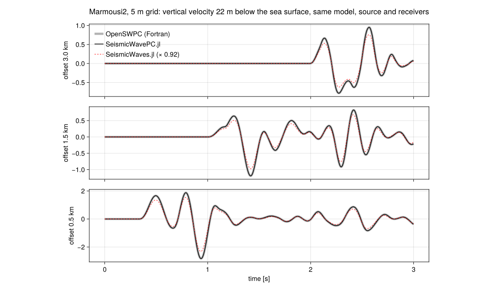

# Validation

The test suite compares seismograms (velocity, displacement, stress and strain) with the Fortran OpenSWPC code (`swpc_psv`,
`swpc_sh`, `swpc_3d`; reference traces are in [`test/reference`](https://github.com/boriskaus/SeismicWavePC.jl/blob/main/test/reference)):

| Solver | Model | Max. difference to OpenSWPC (Cerjan / PML) |
|---|---|---|
| 2D P-SV | two layers, free surface, Q = 50 | 5 × 10⁻⁴ / 3 × 10⁻⁴ |
| 2D SH | two layers, free surface, Q = 50 | 2 × 10⁻⁶ / 2 × 10⁻⁶ |
| 3D | two layers, free surface with a topographic step, Q = 50 | 7 × 10⁻⁶ / 6 × 10⁻⁶ |

On Marmousi2 (5 m grid, 3 s, an explosion and 161 receivers 22 m below the sea surface, PML) the three codes give the same
waveforms. OpenSWPC agrees to 10⁻³ (vertical) and 0.7 % (horizontal velocity) with the same amplitude.
[SeismicWaves.jl](https://github.com/GinvLab/SeismicWaves.jl) agrees to 6 % (vertical) and 2 % (horizontal) after one amplitude
factor per component (it uses the opposite sign of moment tensors and z down; its free surface is half a cell lower and its
receivers are snapped to grid points, which changes amplitudes close to a free surface):

The tests also check:
- misfit gradients against automatic differentiation (Enzyme, agree to round-off) and finite differences of whole simulations,
  in 2D and 3D, with attenuation and waves in the PML; source gradients, misfit options and several shots against finite
  differences;
- MPI runs with 4 processes against serial runs (identical; also the gradients);
- CPU against Metal (agree to 10⁻⁶) and against CUDA on an NVIDIA A100 ([`examples/check_cuda.jl`](https://github.com/boriskaus/SeismicWavePC.jl/blob/main/examples/check_cuda.jl):
  forward simulations and gradients agree to 10⁻¹⁴ in double precision), and MPI on two A100 GPUs against a serial run
  ([`examples/check_cuda_mpi.jl`](https://github.com/boriskaus/SeismicWavePC.jl/blob/main/examples/check_cuda_mpi.jl), also 10⁻¹⁴);
- the interfaces to Optim, LogDensityProblems, ChainRules and ForwardDiff;
- type stability with [JET.jl](https://github.com/aviatesk/JET.jl).

