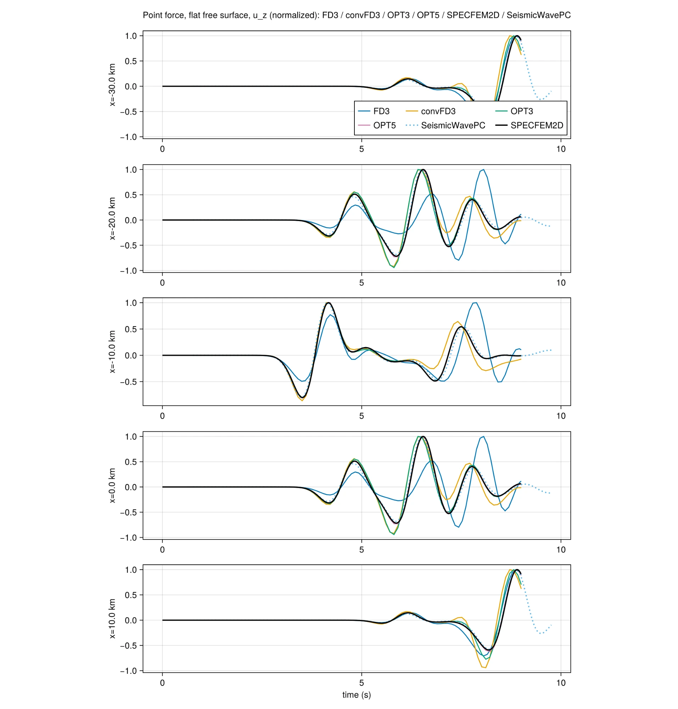
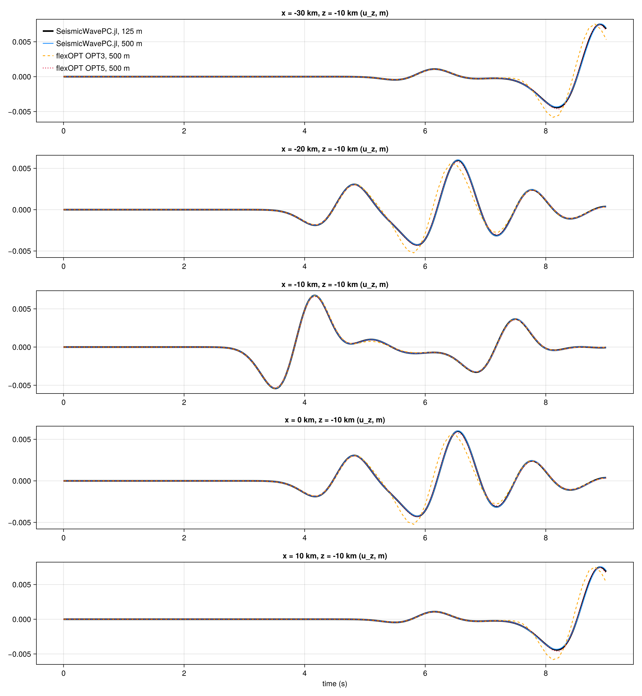
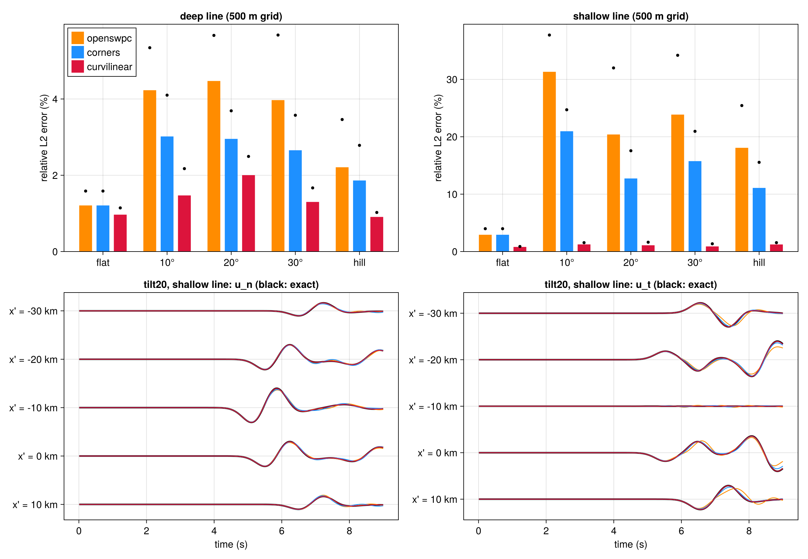
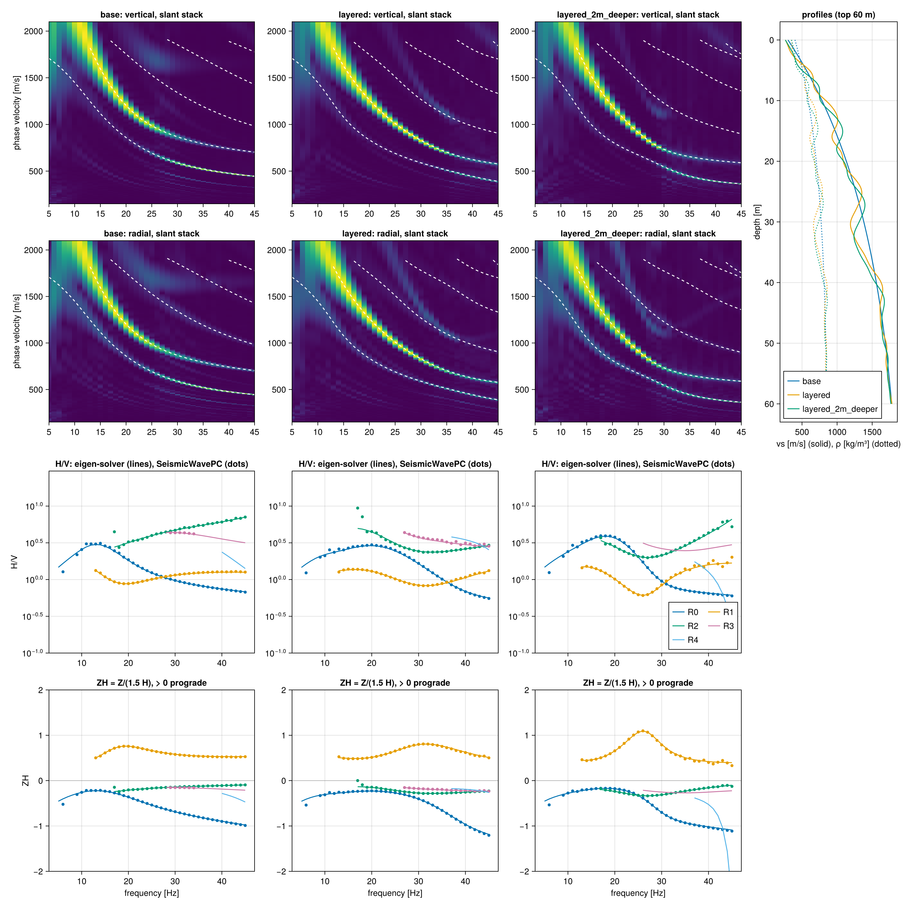
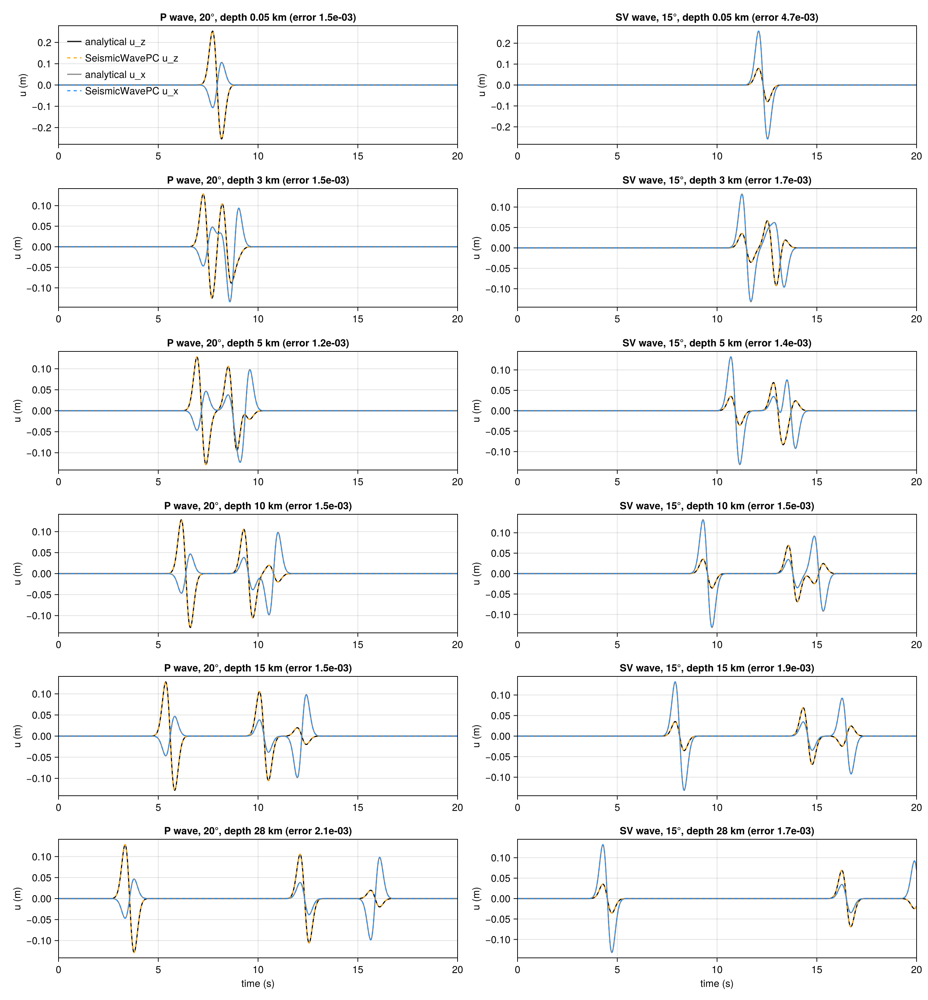

# Validation

The test suite compares seismograms (velocity, displacement, stress and strain) with the Fortran OpenSWPC code (`swpc_psv`,
`swpc_sh`, `swpc_3d`; reference traces are in [`test/reference`](https://github.com/JuliaGeodynamics/SeismicWavePC.jl/blob/main/test/reference)):

| Solver | Model | Max. difference to OpenSWPC (Cerjan / PML) |
|---|---|---|
| 2D P-SV | two layers, free surface, Q = 50 | 5 × 10⁻⁴ / 3 × 10⁻⁴ |
| 2D SH | two layers, free surface, Q = 50 | 2 × 10⁻⁶ / 2 × 10⁻⁶ |
| 3D | two layers, free surface with a topographic step, Q = 50 | 7 × 10⁻⁶ / 6 × 10⁻⁶ |

On Marmousi2 (5 m grid, 3 s, an explosion and 161 receivers 22 m below the sea surface, PML) the three codes give the same
waveforms. OpenSWPC agrees to 10⁻³ (vertical) and 0.7 % (horizontal velocity) with the same amplitude.
[SeismicWaves.jl](https://github.com/GinvLab/SeismicWaves.jl) agrees to 6 % (vertical) and 2 % (horizontal) after one amplitude
factor per component (it uses the opposite sign of moment tensors and z down; its free surface is half a cell lower and its
receivers are snapped to grid points, which changes amplitudes close to a free surface):

## Exact solutions and JUDI.jl (Devito)

Errors are relative L2 differences of all traces after one amplitude factor per component (the codes normalize sources
differently); P-SV, 5 m grid, explosion with the same Ricker wavelet (5 Hz), PML (JUDI.jl: sponge), receivers recording pressure
p and velocities.

**Water half-space against the exact solution** (image source; free surface at z = 0):

| Source / receivers (depth) | Code | p | vx | vz |
|---|---|---:|---:|---:|
| 10 m / 10 m, offsets 0.1–1.5 km | JUDI.jl, 4th order | 3.0 % | 2.7 % | 0.2 % |
| | JUDI.jl, 8th order | 3.0 % | 2.7 % | 0.1 % |
| | SeismicWavePC.jl, `interpolation = :sinc` | 7.3 % | 5.0 % | 0.9 % |
| | SeismicWavePC.jl, `:cell` | 15 % | 5.3 % | 2.5 % |
| 600 m / 10 m (waves from below) | SeismicWavePC.jl, `:sinc` | 0.3 % | 0.9 % | 0.7 % |
| 10 m / 600 m (waves downwards) | SeismicWavePC.jl, `:sinc` | 0.3 % | 0.9 % | 0.9 % |

Pressure and horizontal velocity at a few cells below the free surface, for waves travelling along it, are the hardest case:
there JUDI.jl, with 4th-order differences up to its (flat, mirrored) free surface, is twice as accurate; SeismicWavePC.jl uses
2nd-order differences next to free surfaces, as OpenSWPC, which also handles topography.

**Convergence with the grid spacing** on a smooth model: a flat sea floor at 300 m depth (on a cell boundary for all grids)
over rock with a velocity gradient and a Gaussian anomaly, explosion and 30 receivers 10 m below the sea surface, 1.6 s.
Difference to the 1.25 m solution of either code:

| Run | vs SeismicWavePC.jl 1.25 m (p, vx, vz) | vs JUDI.jl 1.25 m (p, vx, vz) |
|---|---|---|
| SeismicWavePC.jl, 5 m | 2.1 %, 3.6 %, 0.6 % | 5.7 %, 4.2 %, 3.7 % |
| SeismicWavePC.jl, 2.5 m | 1.6 %, 2.3 %, 0.3 % | 5.4 %, 3.2 %, 3.9 % |
| JUDI.jl (8th order), 5 m | 20 %, 11 %, 16 % | 15 %, 8.3 %, 13 % |
| JUDI.jl (8th order), 2.5 m | 11 %, 6.0 %, 8.7 % | 5.8 %, 3.3 %, 4.7 % |
| JUDI.jl (8th order), 1.25 m | 5.3 %, 3.1 %, 4.0 % | — |

The SeismicWavePC.jl seismograms barely change between 5 m and 1.25 m, whereas the difference of JUDI.jl to them halves
with every refinement: JUDI.jl converges to the same solution, but more slowly on this model, as expected when the material
is defined at the grid nodes (the sea floor lies between two nodes) rather than in the cells.

## Point force under a free surface: comparison with SPECFEM2D

An independent benchmark by Nobuaki Fuji, who set it up and ran the codes below (thanks for sharing it), from
[flexOPT.jl](https://github.com/seismobassoon/flexOPT.jl/tree/main/application/forBoris): a
vertical point force (Ricker wavelet, 0.65 Hz) 20 km deep in a homogeneous half-space (vp = 6 km/s, vs = 3.46 km/s,
ρ = 2700 kg/m³) with a flat free surface, receivers 10 km deep at 0–20 km horizontal distance from the source, 500 m grid.
Vertical displacement, each trace normalized to its peak, against SPECFEM2D (spectral elements), the optimal operators OPT3
and OPT5 of flexOPT.jl, and two 3-point finite-difference schemes (FD3, convFD3):

SeismicWavePC.jl (dotted) follows SPECFEM2D (black) in the direct P and S waves and in the waves reflected at the free
surface. The other codes smooth the force with a Gaussian (σ = 500 m), SeismicWavePC.jl uses a point force; its traces
are aligned in time by cross-correlation (the delay of its Ricker wavelet differs).

The same benchmark in its exact conventions
([`examples/point_force_benchmark.jl`](https://github.com/JuliaGeodynamics/SeismicWavePC.jl/blob/main/examples/point_force_benchmark.jl)):
the force of 1e10 N/m with the Gaussian smoothing over the nodes of the 500 m grid, the same Ricker wavelet and the free
surface at z = 0. The displacement in metres, without rescaling or time shifts, against OPT3 and OPT5 of flexOPT.jl
(`application/forBoris/run.jl`, 500 m grid):

Relative L2 differences to SeismicWavePC.jl on a 125 m grid (converged): SeismicWavePC.jl on the 500 m grid 0.8–2.4 %, OPT5
1.1–4.3 %, OPT3 3–30 % (largest at the receivers far from the source).

## Free surface on topography

The same benchmark with topography (the `dev/cutCells` cases of [flexOPT.jl](https://github.com/seismobassoon/flexOPT.jl),
also by Nobuaki Fuji): the free surface tilted by 10, 20 and 30° (source, force along the normal and receivers rotated with
it), and a Gaussian hill (3 km high, σ = 5 km) between the source and the receivers. Two lines of five receivers, 10 km
("deep") and 1 km ("shallow") below the surface; components along (u_t) and normal to the surface (u_n). On the 500 m grid
(16 points per S wavelength) the staggered grid represents the surface as a staircase of cells, with the default free
surface or `free_surface = :corners`; the curvilinear solver (`grid = :curvilinear`, see [Models](models.md)) puts its
nodes exactly on the surface (for the tilts on a mesh whose bottom is parallel to the surface, 80 km below it). The
references: for the tilted planes the exact answer, the flat case rotated (on a 62.5 m grid, where its surface lies on cell
faces); for the hill `free_surface = :corners` on a 62.5 m grid
([`examples/topography_benchmark.jl`](https://github.com/JuliaGeodynamics/SeismicWavePC.jl/blob/main/examples/topography_benchmark.jl),
under a minute on a laptop):

Relative L2 error of (u_t, u_n) over 0–9 s on the 500 m grid, mean (max) over the five receivers of a line:

| Case | deep, default | deep, `:corners` | deep, curvilinear | shallow, default | shallow, `:corners` | shallow, curvilinear |
|---|---|---|---|---|---|---|
| flat | 1.2 % (1.6) | 1.2 % (1.6) | 1.0 % (1.1) | 2.9 % (4.0) | 2.9 % (4.0) | 0.8 % (0.9) |
| 10° | 4.2 % (5.3) | 3.0 % (4.1) | 1.5 % (2.2) | 31 % (38) | 21 % (25) | 1.2 % (1.5) |
| 20° | 4.5 % (5.7) | 3.0 % (3.7) | 2.0 % (2.5) | 20 % (32) | 13 % (18) | 1.1 % (1.6) |
| 30° | 4.0 % (5.7) | 2.7 % (3.6) | 1.3 % (1.7) | 24 % (34) | 16 % (21) | 0.9 % (1.4) |
| hill | 2.2 % (3.5) | 1.9 % (2.8) | 0.9 % (1.0) | 18 % (25) | 11 % (16) | 1.2 % (1.6) |

Away from the surface the staircase costs little (2–4.5 %). Within a fifth of an S wavelength of a sloping surface the
errors are 20–30 %, mostly delays of the waves along the surface (u_t in the figure); `:corners` reduces them by 1.5–2. The
curvilinear solver stays at about 1 % on both lines, as on a flat surface (the hill: at the accuracy of its reference,
whose variants differ by up to 1 %).

Run times per simulation (9 s, 12 threads of an Apple M-series laptop, after compilation), and the mean error on the
shallow line of the sloping cases (10°, 20°, 30°, hill):

| Solver | grid | run time | shallow error |
|---|---|---|---|
| staggered, default | 500 m | 0.06–0.10 s | 18–31 % |
| staggered, `:corners` | 500 m | 0.07–0.12 s | 11–21 % |
| curvilinear | 500 m | 0.12–0.20 s | 0.9–1.2 % |
| staggered, default | 250 m | 0.34–0.41 s | 5.9–8.2 % |
| staggered, `:corners` | 250 m | 0.25–0.50 s | 3.6–4.4 % |
| curvilinear | 250 m | 0.55–0.74 s | 0.6–1.0 % |
| staggered, default | 125 m | 1.2–2.3 s | 1.7–3.7 % |
| staggered, `:corners` | 125 m | 1.3–2.4 s | 1.0–1.8 % |

On the same grid a curvilinear run costs about twice a staggered one (as many time steps here, but more work per node:
7th-order collocated stencils instead of 4th-order staggered ones), but it reaches the accuracy that the staggered grid needs 4×
finer cells for (`:corners` at 125 m), about 10× faster. Near a sloping surface on the staggered grid, use a finer grid
than the 16 points per S wavelength that suffice elsewhere, or the curvilinear solver.

## Rayleigh waves in firn

Firn (compacting snow over glacial ice) has a strong velocity gradient: vs grows from about 300 m/s at the surface to
2000 m/s at 100 m depth, and Rayleigh waves above 5 Hz come in several modes with very different, depth-sensitive particle
motions (Chaput et al., 2022, *J. Glaciol.* 68, 785–798). Their numerical results (Figs. 8 and 9) are Rayleigh modes of 1D
profiles; here SeismicWavePC.jl is compared with a 1D eigen-solver of the same kind (linear finite elements as RAYLEE,
[`test/rayleigh_modes.jl`](https://github.com/JuliaGeodynamics/SeismicWavePC.jl/blob/main/test/rayleigh_modes.jl)) for
three profiles: smooth (as their base model), with random fine layering (their Fig. 8b) and with that layering 2 m deeper
(their Fig. 9). A vertical force (Ricker, 20 Hz) just below the surface, 501 surface stations at 100–1100 m, 0.5 m grid;
the slant stack of the stations at each frequency gives the phase velocity, H/V and sense of the particle motion of each
excited mode
([`examples/firn_rayleigh_benchmark.jl`](https://github.com/JuliaGeodynamics/SeismicWavePC.jl/blob/main/examples/firn_rayleigh_benchmark.jl)):

The modes R0–R3 follow the eigen-solver: the phase velocity to 0.15–0.5 % on average
(2.4 % at 6 Hz, where the 1 km line spans only four wavelengths), H/V to 1–6 % on average (more right at the cutoff
frequency of a mode, where it is hardly excited), and the sense of the motion is right at all but one of 329 picks. As in the
paper, the fundamental mode R0 is retrograde, R1 prograde with H/V ≈ 1, and R2 strongly horizontal (H/V 3–8); the 2 m
shift of the layering moves the features of R1 and R2.

The motion of these modes changes within centimetres of the surface. Surface stations record at the centre of the top
cell (0.25 m deep here), and the eigen-solver is evaluated there too: at the surface itself the H/V of the fundamental mode
at 45 Hz is 0.85 instead of 0.68. Field instruments in firn are usually buried by about this much.

The test suite checks the fundamental mode over a smooth gradient (vs from 800 to 2000 m/s, 10 m grid) against the
eigen-solver: phase velocity to 0.5 % and H/V to 3 % at 16–27 points per S wavelength at the surface. The error grows with
frequency roughly as f², as expected from the 2nd-order differences next to the free surface: 0.2 % at 20 points per S wavelength,
1 % at 10.

## Teleseismic plane waves

`TeleseismicWave` (a plane wave from below, injected along a box) against the analytical solution of a homogeneous
half-space (vp = 6 km/s, vs = 3.46 km/s, 100 m grid, Ricker wavelet of 1 Hz): the incoming P (20°) or SV (15°) wave and the
P and SV waves reflected at the free surface, whose amplitudes follow from the traction-free surface. Displacement at the
surface and at 3–28 km depth
([`examples/teleseismic_benchmark.jl`](https://github.com/JuliaGeodynamics/SeismicWavePC.jl/blob/main/examples/teleseismic_benchmark.jl)):

The relative L2 differences are 0.1–0.2 % (0.5 % for SV at the surface). Also checked:
- a crust (30 km, vp = 6 km/s) over a mantle, P, SV and SH, against the exact layered solution: 0.1–0.25 %; the same on a grid
  stretched in depth (50 m at the surface, 200 m at depth): 0.1–0.6 %;
- 3D, a P wave from the backazimuth 240° and an SH wave from 200° (oblique to the grid) in a crust over a mantle: all three
  components to 0.06–0.2 %;
- the free-surface response of a half-space, P at 0–40°: the ratio of horizontal and vertical motion exact to 2·10⁻⁴, the
  same amplitude everywhere along the surface (10⁻⁴), waves leaking out of the box 4–8·10⁻⁴ (`PlaneWave`, the OpenSWPC initial
  wavefield, gives 4 % of spurious horizontal motion at vertical incidence and is cut at oblique incidence);
- misfit gradients with a teleseismic wave against Enzyme (round-off, also at the box boundary), finite differences, and MPI.

The tests also check:
- misfit gradients against automatic differentiation (Enzyme, agree to round-off) and finite differences of whole simulations,
  in 2D and 3D, with attenuation and waves in the PML; source gradients, misfit options and several shots against finite
  differences;
- Rayleigh waves over a velocity gradient against the eigen-solver (see [Rayleigh waves in firn](@ref));
- MPI runs with 4 processes against serial runs (identical; also the gradients);
- CPU against Metal (agree to 10⁻⁶) and against CUDA on an NVIDIA A100 ([`examples/check_cuda.jl`](https://github.com/JuliaGeodynamics/SeismicWavePC.jl/blob/main/examples/check_cuda.jl):
  forward simulations and gradients agree to 10⁻¹⁴ in double precision), and MPI on two A100 GPUs against a serial run
  ([`examples/check_cuda_mpi.jl`](https://github.com/JuliaGeodynamics/SeismicWavePC.jl/blob/main/examples/check_cuda_mpi.jl), also 10⁻¹⁴);
- the interfaces to Optim, LogDensityProblems, ChainRules and ForwardDiff;
- type stability with [JET.jl](https://github.com/aviatesk/JET.jl).

