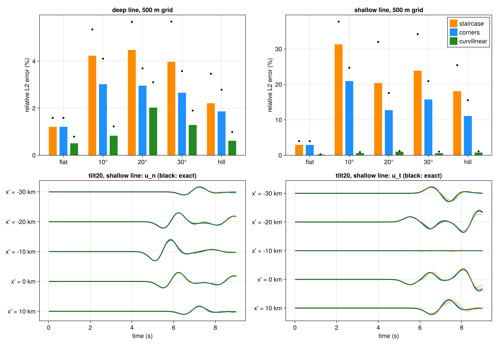

# Prototype: terrain-following grid with SBP-SAT (2D P-SV)

A standalone prototype, not part of the package. Does a grid that follows the topography, with a provably stable free
surface, fix the accuracy of the staircase free surface near slopes?

**Scheme** ([`curvi.jl`](curvi.jl)):
- grid: x = ξ, z = η + h(ξ) w(η), with the surface h(x) at η = 0. Either w = 1 (columns sheared with the surface
  everywhere) or w goes smoothly from 1 at the surface to 0 at a depth D (terrain-following near the surface only,
  Cartesian below);
- collocated velocity-stress, material parameters as point values (averaged over each node's cell);
- dual-pairing upwind SBP operators from [SummationByPartsOperators.jl](https://github.com/ranocha/SummationByPartsOperators.jl):
  H D₊ + (H D₋)ᵀ = B, D₋ for the divergence, D₊ for the gradient;
- free surface by SAT: the traction is removed weakly (also at the other boundaries, which are far away);
- metric terms computed with the divergence operators;
- RK4.

The divergence and the gradient are adjoint in the J-weighted SBP norm, so the semi-discrete energy is conserved for any
mapping and any material. The scheme is stable over 40 s on 45° slopes and hills; the energy changes by 4·10⁻⁵ (RK4).

The tests are the topography cases of Nobuaki Fuji (flexOPT.jl `dev/cutCells`, as
[`examples/topography_benchmark.jl`](../../examples/topography_benchmark.jl)): tilted planes and hills, a vertical force
20 km deep, and receivers 10 km ("deep") and 1 km ("shallow") below the surface. The references are SeismicWavePC runs
on a 62.5 m grid: the exact flat case for the tilts, `:corners` for the hills. Errors are relative L2, the mean over
5 receivers.

## 1. Free surface on topography (500 m grid, 16 points per S wavelength)

[`compare.jl`](compare.jl); curvilinear with the operators of Mattsson, Niemelä & Winters (2026), order 7:

| case | staircase deep / shallow | `:corners` | curvilinear |
|---|---|---|---|
| flat | 1.2 / 2.9 % | 1.2 / 2.9 % | 0.5 / 0.2 % |
| 10° | 4.2 / 31 % | 3.0 / 21 % | 0.8 / 0.6 % |
| 20° | 4.5 / 20 % | 3.0 / 13 % | 2.0 / 1.0 % |
| 30° | 4.0 / 24 % | 2.7 / 16 % | 1.3 / 0.6 % |
| hill | 2.2 / 18 % | 1.9 / 11 % | 0.6 / 0.8 % |

## 2. Which operators: higher order is not always better

[`operators.jl`](operators.jl), deep / shallow:

| operators | flat | 20° | hill |
|---|---|---|---|
| Mattsson (2017), order 5 | 1.7 / 3.2 % | 3.1 / 2.7 % | 1.9 / 3.4 % |
| Mattsson (2017), order 7 | 1.0 / 16.5 % | 2.2 / 12.9 % | 0.9 / 16.7 % |
| Williams & Duru (2024, dispersion-relation preserving), order 5 | 0.7 / 2.1 % | 2.1 / 1.9 % | 0.8 / 2.2 % |
| Williams & Duru (2024), order 7 | 2.7 / 21.6 % | 3.1 / 24.5 % | 1.7 / 20.9 % |
| **Mattsson, Niemelä & Winters (2026, boundary-optimized), order 7** | **0.5 / 0.2 %** | **2.0 / 1.0 %** | **0.6 / 0.8 %** |
| Mattsson, Niemelä & Winters (2026), order 9 | 0.3 / 0.2 % | 1.9 / 1.0 % | 0.4 / 0.8 % |

- **Standard closures:** near the free surface they are less accurate and wider for higher orders. At 500 m the closure
  of order 7 spans the top 4–5 km, so the shallow line gets worse with the order. Even orders are worse in the interior.
- **Boundary-optimized closures** (a few non-equidistant points at the boundary) remove this: higher order pays again.
  Their order 8 is stable but stiff (spectral radius 18/h; order 7: 4.6/h, Mattsson order 5: 2.0/h), so it needs a
  much smaller time step.
- **Central SBP operators fail.** With them (Mattsson & Nordström 2004), point forces excite spurious grid-scale modes
  of the collocated grid: 5–9 % at 500 m, growing under refinement. The dual-pairing operators behave like a staggered
  grid.

## 3. Terrain-following near the surface only

[`experiments.jl`](experiments.jl), part 1; deep / shallow, 500 m grid:

| mapping | hill (σ = 5 km) | steep hill (σ = 2 km, slopes to 42°) |
|---|---|---|
| staircase / `:corners` | 2.2 / 18 %, 1.9 / 11 % | 2.5 / 16 %, 1.6 / 8.9 % |
| curvilinear, sheared everywhere | 0.6 / 0.8 % | 1.1 / 0.8 % |
| flattened at D = 20 km (J ≤ 1.22) | 0.5 / 0.8 % | 0.5 / 0.8 % |
| D = 10 km (J ≤ 1.45) | 0.5 / 0.8 % | 0.5 / 0.8 % |
| D = 6 km (J ≤ 1.75) | 0.5 / 1.0 % | 0.5 / 0.7 % |

Flattening costs nothing; with steep topography it even improves the interior (no sheared cells there). On a 45° tilted
plane, sheared everywhere, the deep line is worse (3.6 %, shallow 1.3 %).

## 4. A low-velocity layer under the surface

[`experiments.jl`](experiments.jl), part 2. A layer 2 km thick (vp = 3.5, vs = 2.0 km/s, ρ = 2200 kg/m³) parallel to the
tilted surfaces; the exact reference is the flat layered case with the interface on cell faces. 250 m grid:

| case | staircase deep / shallow | `:corners` | curvilinear |
|---|---|---|---|
| flat | 0.3 / 1.5 % | 0.3 / 1.5 % | 0.9 / 3.3 % |
| 10° | 1.2 / 13 % | 1.2 / 8.8 % | 0.9 / 1.5 % |
| 20° | 1.9 / 10 % | 1.9 / 9.3 % | 2.1 / 3.2 % |
| 30° | 1.0 / 8.5 % | 0.9 / 8.4 % | 1.2 / 2.3 % |
| hill (D = 10 km), 250 / 125 m | 0.8 / 9.3 % | 0.8 / 9.1 % | 0.5 / 2.9 %, 0.3 / 1.8 % |

Heterogeneity is no problem for stability: the energy proof holds for any material. On slopes the layer is 3–6× more
accurate than with the staircase. However:
- **A sharp interface between grid nodes dominates the error** (first order, whatever the order of the operators; order 5
  is even slightly better than 7 here).
- **On a flat surface, with the interface on cell faces, the staircase is better.**
- **The remedy** is to make material interfaces grid lines: blocks coupled by SAT interface conditions (standard
  multi-block SBP), natural for layers that follow the topography (firn, weathered layers).

## Not done

- absorbing boundaries;
- attenuation;
- multi-block material interfaces;
- 3D;
- leapfrog time stepping (instead of RK4: the cost per step here is not representative);
- gradients.

## Run

    julia -t auto --project=prototypes/curvilinear prototypes/curvilinear/compare.jl        # section 1 (~1 min)
    julia -t auto --project=prototypes/curvilinear prototypes/curvilinear/operators.jl      # section 2 (~2 min)
    julia -t auto --project=prototypes/curvilinear prototypes/curvilinear/experiments.jl    # sections 3, 4 (~4 min)
    FAMILY=Mattsson2017 ORDER=5 julia -t auto --project=prototypes/curvilinear prototypes/curvilinear/curvi.jl hill 500 40 10000
